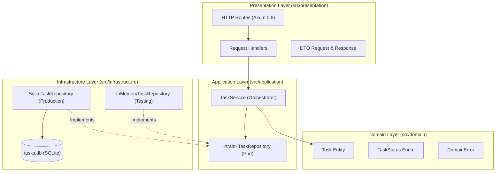

# Development Workflow & Panduan Vibe Coding

Dokumen ini menjelaskan alur kerja (*development workflow*), arsitektur sistem, dan panduan praktik *vibe coding* yang diterapkan pada repositori **rustapi**.

---

## 1. Arsitektur & Prinsip Desain

Proyek ini menggunakan **Clean Architecture** (Onion / Hexagonal Architecture) dengan mematuhi prinsip **Dependency Inversion** di bahasa Rust.



### Aturan Ketergantungan (Dependency Rule):
1. **Domain (`src/domain/`)**: Inti bisnis. Sama sekali tidak memiliki dependensi ke framework luar (tidak bergantung pada Axum, SQLx, Tokio, dll). Menjamin aturan bisnis murni, validasi karakter Unicode, dan enkapsulasi state.
2. **Application (`src/application/`)**: Mengorkestrasi aliran bisnis (Use Cases) melalui `TaskService`. Berinteraksi dengan database hanya melalui abstraksi *trait* `TaskRepository` (*Port*).
3. **Infrastructure (`src/infrastructure/`)**: Implementasi konkret (*Adapter*). Berisi `SqliteTaskRepository` (berbasis SQLx connection pool) dan `InMemoryTaskRepository` (untuk pengujian instan).
4. **Presentation (`src/presentation/`)**: Menangani protokol HTTP (Axum 0.8), serialisasi/deserialisasi JSON, dan pemetaan error domain ke status code HTTP yang sesuai.
5. **Composition Root (`src/main.rs`)**: Titik perakitan. Menginisialisasi koneksi SQLite, membungkus repository ke dalam `Arc<dyn TaskRepository>`, dan menyuntikkannya ke `TaskService`.

---

## 2. Siklus Pengembangan Vibe Coding

Untuk bekerja secara efektif dengan AI coding agent (seperti Antigravity), ikuti siklus iterasi berikut:

### Langkah 1: Perencanaan & Kontrak (`/plan`)
- Jangan langsung menulis kode implementasi tanpa arah.
- Gunakan perintah `/plan` untuk merumuskan rancangan arsitektur, DTO, dan perubahan skema terlebih dahulu.
- Pastikan ekspektasi *trade-off* (misalnya single crate vs multi-crate, SQLite vs Postgres) telah disepakati bersama sebelum eksekusi dimulai.

### Langkah 2: Inside-Out Development (Domain First)
Urutan implementasi yang ideal:
1. **Domain Layer**: Buat struct entity, enum status, dan unit test validasinya.
2. **Application Layer**: Buat port trait dan use case service.
3. **Infrastructure Layer**: Buat adapter database yang mengimplementasikan trait.
4. **Presentation Layer**: Buat handler HTTP, router, dan konversi error.

*Keuntungan:* Logika bisnis dapat diuji secara instan dengan unit test tanpa perlu menyalakan database atau web server.

### Langkah 3: Verifikasi Kualitas Otomatis
Setelah perubahan kode diterapkan oleh agent, selalu jalankan tiga serangkai perintah verifikasi Rust:
```bash
# 1. Jalankan seluruh unit & integration test
cargo test

# 2. Periksa standar kualitas & keamanan kode (0 warnings)
cargo clippy --all-targets -- -D warnings

# 3. Pastikan format kode konsisten
cargo fmt --check
```

### Langkah 4: Code Review dengan Senior Dev Skill (`/ponytail-review`)
- Panggil skill audit **`ponytail`** menggunakan `/ponytail-review` untuk meninjau perubahan dari kacamata *senior developer*:
  - Memeriksa potensi bug (misal: byte length vs Unicode character count).
  - Memeriksa konkurensi (lock contention pada async RwLock).
  - Memeriksa enkapsulasi dan penghapusan *dead code* (YAGNI).

---

## 3. Menjalankan & Menguji Proyek

### Menjalankan Server Lokal:
```bash
cargo run
```
Server akan berjalan di `http://127.0.0.1:3000`. File database `tasks.db` dan tabel `tasks` akan otomatis diinisialisasi jika belum ada (*auto-migration*).

### Menggunakan Database URL Kustom:
Anda dapat mengatur environment variable `DATABASE_URL`:
```bash
DATABASE_URL="sqlite://custom.db?mode=rwc" cargo run
```

### Menjalankan Pengujian:
```bash
# Menjalankan seluruh test suite (unit + API + SQLite)
cargo test

# Menjalankan test spesifik SQLite
cargo test --test sqlite_tests

# Menjalankan test spesifik HTTP API
cargo test --test api_tests
```
